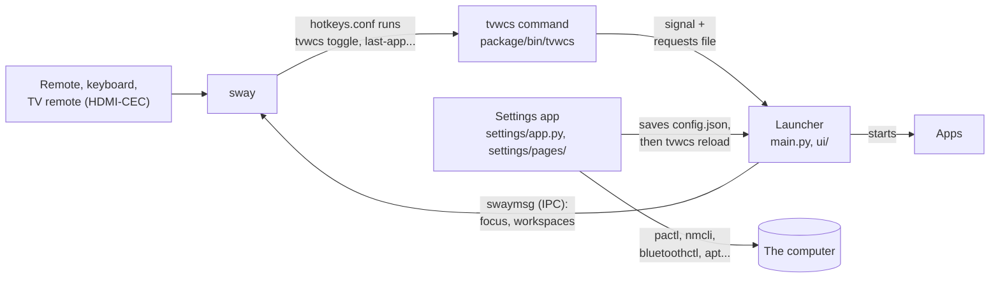

# TVWCS: project overview

This document is for people working on TVWCS: what it is for, how it works inside, how the code is laid out and how releases are made. What it does for the user, page by page and key by key, is in [README.md](README.md).

## Goal

**Make a Linux computer as easy to use from the couch as a TV, without taking control away from Linux or its apps.**

**TVWCS is:** a TV-style launcher and app switcher on sway; one search for apps, profiles, channels and open windows; a user-made channel list and favorites; a Settings app for what a TV computer needs; built on standard `.desktop` metadata and the sway IPC.

**TVWCS is not:** an operating system or window manager; a media player (Kodi, VLC, Jellyfin); a promise that every app becomes D-pad friendly; a plugin system; a fixed channel list.

## Design

The look follows Metro (Modern UI): flat and typographic. The Retro theme swaps in an old CRT TV's menus but keeps the same layout.

- **Square, solid colour.** No rounded corners, gradients or shadows. Dark by default (light is an option), one accent colour, high text contrast.
- **Clear focus.** The selected item is a solid accent block with a white frame. Dangerous actions turn red.
- **Real icons.** App logos wherever an app is listed, a coloured letter tile when there is none. Symbols where the meaning is universal (⏻ ✕ ⋯ ☆ ✎ ⊞), words elsewhere.
- **Scales to the room.** Interface sizes 1 to 5, plus a 4K switch. A change applies at once.
- **Everything in one window.** Dialogs, editors, messages and the on-screen keyboard are drawn inside the TVWCS window, so they cannot get lost behind it.
- **Remote first.** Every control is reachable with arrows, OK and Back. Navigation is spatial; Back steps back one level (dialog, Applications, Quick Menu); typing anywhere goes into search.

## How it works

**The window.** TVWCS is one borderless floating sway window (plain GTK 4 through python3-gi, no libadwaita or layer-shell; only the volume indicator, `ui/osd.py`, is a gtk4-layer-shell overlay so it shows over full-screen apps), placed over IPC in the usable area of the focused monitor. It holds the Quick Menu and, beside it, Applications. TVWCS computes the exact position at run time from the Quick Menu corner and the screen edge margin (which also handles overscan). `tvwcs.conf` maps it with opacity 0 until it is placed, so it never flashes in the centre. TVWCS recognises its own windows by the exact title `TVWCS` or the prefix `TVWCS · `.

**TV mode and desktop mode.** TV mode is the TVWCS session (`tvwcs-session` exports `TVWCS_SESSION`); any other sway session with the `include /usr/share/tvwcs/tvwcs.conf` line is desktop mode. TV mode adds what a TV needs: no swaybar (`tvwcs-session` writes its sway config with the bar commented out), the pointer hidden (`seat * hide_cursor`, `system/cursor.py`), the Quick Menu kept open while no app is, and the TVWCS lock screen.

**Launch profiles.** An application is the installed program; a launch profile is one way to start it (a name and, optionally, a command, a `.desktop` action, a channel, a favorite flag, a launch mode, a description, a hotkey and a PIN). A custom command runs as an argument list, never through a shell. A profile with no changes of its own follows its app when the `.desktop` file is renamed. The PIN is a convenience lock, not security. Channels (1 to 4 digits, `channel_digits`, 2 by default) are unique and optional.

**Where apps open** (`apps_open`): full screen one per workspace (the TV default), side by side (the desktop default), or as each profile says. Nothing is moved, closed or minimized; other workspaces just aren't shown. TVWCS focuses an existing window rather than starting a second copy when it can match one by class, instance, `StartupWMClass` and name, which is best-effort. sway stays in charge of windows; TVWCS only sends it commands.

**Hotkeys** (`core/hotkeys.py`) are written to `~/.config/tvwcs/hotkeys.conf`, which `tvwcs.conf` includes. A modifier tapped alone (Super) is bound by keycode on release, so Super combinations keep working. Each device has a Quick Menu key and a Last app key (`tvwcs last-app`, Super+Tab by default): sway keeps no focus history, so `system/last_app.py` follows its window events (`swaymsg -t subscribe`) and falls back on the tree's `focus` lists for windows focused before TVWCS started. Remote media keys are written with their `XF86` names.

**Power and locking.** Power actions use `systemctl`. When polkit refuses, TVWCS uses a no-password sudo or doas rule if there is one, else asks for the sudo password in its own dialog and passes it to `sudo -S` without storing it. Idle times (screen off, lock, sleep, and a second set on battery) go to `swayidle`, whose timeouts call `tvwcs idle <action>` back; sound playing or an inhibiting app keeps the computer awake. The lock screen (`system/lockscreen.py`, TV mode only) is swaylock with an SVG made at lock time from the theme. A desktop session's lock screen is never changed.

**Server mode** (`system/servermode.py`) is a root-owned `/etc/tvwcs/server-mode` naming the account, plus a polkit rule that refuses logind, UDisks2 and NetworkManager actions for it. Settings hides admin-only rows and turns off Power, Software updates and Network there.

**Settings** is a separate GTK app (`tvwcs settings [page]`) in the same style. It drives standard tools rather than services of its own: `pactl`, `swaymsg`, `bluetoothctl`, `nmcli` (or iwd over `busctl`, and a read-only `ip` fallback), `timedatectl`, apt or pacman, `udisksctl`, and OpenSSH through `systemctl`. A page whose software is missing offers to install it (`system/features.py`). Each page is also a `.desktop` action, so it can be a channel or a favorite. Changes the running TVWCS needs to know about are sent with `tvwcs reload`.

## Supported systems

Debian and its family (Ubuntu LTS, Mint, Pop!_OS, Raspberry Pi OS) with apt, Arch and its family with pacman, and Fedora with dnf (5.15.0; Atomic editions only by layering the .rpm), all with systemd and sway. `system/distro.py` holds each family's package names, install commands and greetd details. Other distributions, non-systemd init systems, i3/X11 and Flatpak were removed along the way; the CHANGELOG says when, and git history has the code.

## Packages and installer

- **Debian:** one package, `tvwcs_<version>_all.deb`, built by `scripts/build-debs.sh` with plain `dpkg-deb` (nothing is compiled) from `packaging/tvwcs/`. It conflicts with 5.0.x's `tvwcs-boot-logo`, so apt removes that.
- **Fedora:** `scripts/build-rpm.sh` fills in `packaging/fedora/tvwcs.spec.in` and builds `tvwcs-<version>-1.noarch.rpm` with rpmbuild (on Fedora; the release workflow runs it in a Fedora container). Its `%preun` undoes TVWCS's setup like the .deb's prerm, only on removal.
- **Arch:** `scripts/build-arch.sh` fills in `packaging/arch/PKGBUILD.in` and `tvwcs.install` with the version and the source tarball's checksum. `--package` also runs makepkg.
- **What's installed:** the Python package in `/usr/lib/tvwcs`, `/usr/bin/tvwcs`, `/usr/bin/tvwcs-session` (it makes `~/.config/tvwcs/sway-session.conf` from `/etc/sway/config` the first time, writes default hotkeys and runs sway), the session entry `tvwcs-sway.desktop`, `/usr/share/tvwcs/tvwcs.conf` and the Settings launcher. Installing changes no settings.
- **Login:** TVWCS has no login screen of its own and never installs one. `system/loginscreen.py` sets the automatic login where the login screen in use keeps it (greetd's initial session, LightDM's or SDDM's settings), or without one a console autologin (`getty@tty1` drop-in plus a `~/.profile` block).
- **`install.sh`** (POSIX sh, at the repository root) runs in a terminal, on its own (`wget -qO- …/releases/latest/download/install.sh | bash`, then it downloads the chosen release; each release has its own copy attached, so an installer change reaches new installs only once its release is promoted) or from an unpacked `tvwcs.tar.gz`. It asks everything first, then installs with apt (dnf on Fedora, with `dnf downgrade` for an older version; it stops on Fedora Atomic), or on Arch builds the PKGBUILD with makepkg and installs it with pacman. `--remove` removes the package and TVWCS's changes to sway, greetd and the console login.
- **Self-update** (`system/selfupdate.py`) downloads a release's .deb and installs it with `apt-get install` as root, or on Fedora its .rpm with `dnf install` / `downgrade` / `reinstall` (the package's `/usr/lib/tvwcs/PACKAGE` says `fedora`). On Arch it only says a release is out.

## Where things live

| What | Where |
|---|---|
| The program | `/usr/lib/tvwcs/` (`/usr/bin/tvwcs`, `/usr/bin/tvwcs-session`) |
| sway fragment (starts TVWCS, includes hotkeys, window rules) | `/usr/share/tvwcs/tvwcs.conf` |
| User data and settings | `~/.config/tvwcs/config.json` |
| Hotkeys, written by TVWCS | `~/.config/tvwcs/hotkeys.conf` |
| Kept display settings | `~/.config/tvwcs/displays.json` |
| TVWCS's own session config (TV mode) | `~/.config/tvwcs/sway-session.conf` |
| Server mode | `/etc/tvwcs/server-mode` |
| PID file and per-session files | `$XDG_RUNTIME_DIR` |

User data is kept apart from the program, so upgrades never touch it.

## Code

New to the code? Start with [CONTRIBUTING.md](CONTRIBUTING.md) (running it, tests, style) and
[docs/WHERE-TO-CHANGE.md](docs/WHERE-TO-CHANGE.md) (which file to open for a given change).

### How the parts talk to each other



- **The launcher** is one GTK process (`main.py`, `TVWCSApp`). It owns the TVWCS window (`ui/window.py`) and the
  watchers (`watchers.py`) that follow idle time, the volume, the TV remote and the status icons. It is told what to
  do through the `tvwcs` command: sway's key bindings (`hotkeys.conf`, written by `core/hotkeys.py`) run `tvwcs toggle`
  and friends, which send the running launcher a signal, or write a line to a requests file and then signal it
  (`send_signal` and `send_request` in `main.py`).
- **The Settings app** is a second GTK process (`tvwcs settings`). Each page reads the system on a worker thread
  through its back end, then draws rows. A change to TVWCS's own options is saved to `config.json`, and the running
  launcher is asked to read it again.
- **Root.** Anything that needs root runs `python3 -m tvwcs.<module> <command>` through sudo (or polkit), from the
  same copy of TVWCS (`tvwcs.LIB_DIR` on `PYTHONPATH`).

### Where the code is

Everything below `package/tvwcs/`. Modules outside `ui/`, `settings/app.py` and `settings/pages/` have no GTK
dependency and are tested without a display.

| Folder | What is in it |
|---|---|
| `main.py`, `watchers.py`, `usage.py` | The launcher app and its command line (`tvwcs …`), what it keeps an eye on, `tvwcs help` |
| `core/` | Data and rules: launch profiles and settings (`model.py`), installed apps (`applications.py`), open windows by workspace (`workspaces.py`), hotkeys (`hotkeys.py`), PINs, vendor presets |
| `system/` | TVWCS's side of the computer: sway IPC (`window_manager.py`), power and idle (`power.py`), the lock and login screens, server mode, HDMI-CEC (`cec.py`), the Last app key, TVWCS's own updates, distribution differences (`distro.py`, `features.py`) |
| `settings/` | The Settings app: its window (`app.py`), one file per page in `pages/` (GTK), and each page's back end beside them (`sound.py`, `network.py`, `updates.py` …, no GTK) |
| `ui/` | The launcher's window, split by part: `window.py` builds it; `quick_menu.py`, `applications_pane.py`, `status_panels.py`, `search.py`, `navigation.py`, `dialogs.py` and `onscreen_keyboard.py` each add one part. Also the profile editor (`editors.py`), the themes (`theme.py`, `retro.py`, `retro_assets/`), shared widgets and the volume indicator (`osd.py`) |
| `loginscreen.py`, `control_ubuntu.py` | Old names kept for TVWCS 5.21's installer; remove once no release older than 5.22.0 is offered |

```
package/tvwcs/   the program (above)      package/tests/  unit tests, test_<module>.py
package/bin/     the tvwcs command        data/           tvwcs.conf, the session, .desktop files, icons, the CEC udev rule
scripts/         tests, packages, release packaging/      the Debian control files, the Fedora spec and the Arch PKGBUILD
docs/            install guides, vendors, where to change what
tools/demo/      README screenshots and demo GIFs, made in a headless sway session
```

```sh
./scripts/run-tests.sh            # unit tests (no display needed)
black .                           # the code style (settings in pyproject.toml)
./scripts/build-debs.sh           # resources/tvwcs_<version>_all.deb
./scripts/build-rpm.sh            # resources/fedora/: tvwcs.spec, the source tarball and (on Fedora) the .rpm
./scripts/build-arch.sh           # resources/arch/: PKGBUILD, tvwcs.install, the source tarball (--package on Arch builds it)
./scripts/make-release.sh         # all of that, plus resources/tvwcs.tar.gz and resources/TVWCS-<version>.zip
```

CI (`.github/workflows/ci.yml`) runs the unit tests on Ubuntu, and on Arch also builds the package, installs it with pacman, runs namcap and removes it; in a Fedora container it builds the .rpm, installs it with dnf, lists updates as a normal user, installs a newer .rpm and rolls back, checks greetd's Fedora details and removes it.

## Releases

Versions are `MAJOR.MINOR.PATCH`: MAJOR for big or breaking changes, MINOR for new features, PATCH for fixes.

1. **Bump the version** in `VERSION` and add a dated section at the top of `CHANGELOG.md`. A change to docs, tests or CI only can skip this: without a new version, nothing is published.
2. **Merge to `main`.** If that version has no release yet, `.github/workflows/release.yml` runs the tests, builds everything above and publishes it as the **prerelease** `v<version>`. TVWCS offers it only to people who turned on **Include prereleases**.
3. **Test it** on a TV computer if it has changes that couldn't be checked before merging.
4. **Promote it** with the **Promote** workflow (Actions tab) and the tag, such as `v5.13.0`. It marks the release **latest**, which Check for TVWCS updates, Roll back and the installer use by default.

**Installer:** README installs with `releases/latest/download/install.sh`, the copy attached to the latest release, so `install.sh` on `main` reaches new installs only once its release is promoted.

Other ways: a push to the `beta` branch builds a prerelease tagged `beta-<run number>`; a tag such as `v5.13.0` pushed by hand is published as latest straight away.

### Sending it to the AUR

Each release's `PKGBUILD` and `tvwcs.install` are ready for the AUR. Only promoted releases should go there, since every new version is an update for everyone who installed it.

1. Make an account at <https://aur.archlinux.org/register> and an SSH key just for it (`ssh-keygen -t ed25519 -f ~/.ssh/aur`). Paste `~/.ssh/aur.pub` into My Account › SSH Public Key, and add `Host aur.archlinux.org`, `IdentityFile ~/.ssh/aur` and `User aur` to `~/.ssh/config`.
2. On Arch, `git clone ssh://aur@aur.archlinux.org/tvwcs.git` (the first push creates it).
3. Copy in the release's `PKGBUILD` and `tvwcs.install` and run `makepkg --printsrcinfo > .SRCINFO`. Check with `makepkg -si`, `namcap PKGBUILD` and `namcap tvwcs-*.pkg.tar.zst`; `pkgctl build` (from `devtools`) shows whether a dependency is missing.
4. Put your name on the `# Maintainer:` line, then commit `PKGBUILD`, `.SRCINFO` and `tvwcs.install` and `git push` to `master`. For each later promoted release, copy in the new files, regenerate `.SRCINFO` and push again.
